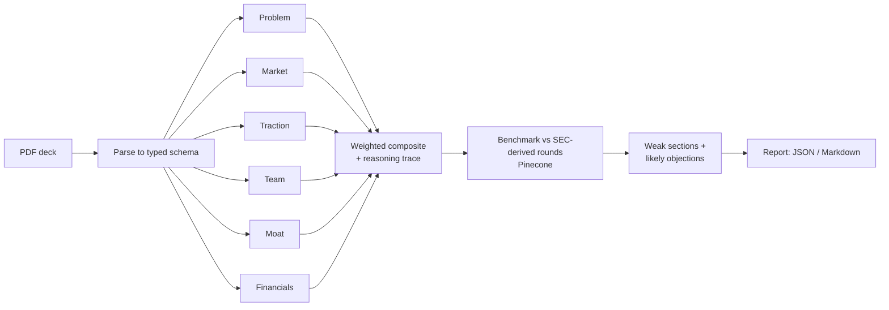

# AutoPitch

[](https://github.com/shamanth811/autopitch/actions/workflows/ci.yml)


An AI analyzer for VC pitch decks. Upload a PDF and get section-by-section scores with
reasoning, a weighted composite, a benchmark of the raise against comparable rounds from SEC
filings, and the objections a sector investor is most likely to raise.

It ships as a full web app (landing page, upload, live progress, saved reports, methodology and
privacy pages) on top of a JSON API.

**Stack:** LangGraph · Groq (gpt-oss / Llama) with optional Gemini · Voyage embeddings ·
Pinecone · FastAPI + SQLite · React + Vite · LangSmith

## How it works



1. **Parse.** Slide text is extracted from the PDF and converted by the extraction model
   (Gemini if configured, otherwise the Groq model) into a typed
   pydantic `Deck` (problem, market, traction, team, moat, financials). Fields the deck does
   not state stay empty instead of being guessed.
2. **Score.** Six independent LangGraph nodes, one per section, run in parallel. Each scores
   its own section against a rubric, criterion by criterion, with a short reasoning trace.
3. **Combine.** Section scores are averaged in code and combined with stage-dependent weights
   (pre-seed favours team, Series A favours traction). Weights live in
   [`rubric.py`](src/autopitch/scoring/rubric.py) and can be tuned without touching graph code.
4. **Benchmark.** Two independent layers, each optional:
   - *Raise size* against thousands of real private placements from SEC **Form D** filings,
     filtered to young companies in the deck's sector: quartiles and the ask's percentile.
   - *Similar companies* from SEC **S-1** filings: the deck is embedded (Voyage or Gemini) and
     matched against rounds extracted from those filings, stored in Pinecone.
5. **Objections.** Weak sections and benchmark findings drive a list of the objections an
   investor in that sector would likely raise, with the evidence a founder should bring.

More detail and design rationale: [docs/ARCHITECTURE.md](docs/ARCHITECTURE.md).

## Quickstart

```bash
git clone https://github.com/shamanth811/autopitch.git
cd autopitch
python -m venv .venv && source .venv/bin/activate   # Windows: .venv\Scripts\activate
pip install -e ".[dev]"
cp .env.example .env                                # then add your keys
```

Run the test suite (offline, no keys needed):

```bash
python scripts/verify.py
```

Minimum keys for a working analysis: `AUTOPITCH_LLAMA_API_KEY` (a Groq key; the model is
`AUTOPITCH_LLAMA_MODEL`, default a current Groq-hosted model). Everything else is optional.

Analyze a deck from the command line:

```bash
python examples/make_sample_deck.py                 # writes a fictional sample deck
python scripts/analyze.py examples/acme_grid_deck.pdf --out reports/acme
```

Run the web app (two terminals):

```bash
uvicorn autopitch.api:app --port 8000
cd frontend && npm install && npm run dev           # http://localhost:5173, proxies /v1 to :8000
```

For a single-process deployment, build the UI once and let the API serve it:

```bash
cd frontend && npm run build
AUTOPITCH_FRONTEND_DIR=frontend/dist uvicorn autopitch.api:app --port 8000   # http://localhost:8000
```

Or call the API directly:

```bash
curl -F "file=@examples/acme_grid_deck.pdf" "http://localhost:8000/v1/analyze?format=markdown"
```

Build the raise-size benchmark from SEC Form D filings (no API key; needs only a SEC-compliant
user agent, downloads about 3 MB per quarter, loads a local SQLite file):

```bash
python scripts/ingest_formd.py --quarters 8
```

Check sector-classification accuracy and stability against a labelled set (uses model tokens):

```bash
python scripts/eval_sector.py --repeats 2
```

Build the similar-companies index from S-1 filings (needs an embedding key, Pinecone and a
SEC-compliant user agent):

```bash
python scripts/ingest_filings.py                    # a spread of sector queries, one filing per company
python scripts/ingest_filings.py --query '"Series A preferred stock" fintech' --limit 10
```

To make realistic test decks (fictional companies, real sourced market data, simulated and
internally consistent company numbers), see [docs/deck-generation-prompt.md](docs/deck-generation-prompt.md)
and `scripts/build_decks.py`.

## Configuration

All settings are environment variables prefixed `AUTOPITCH_`; see
[`.env.example`](.env.example). Highlights:

- **Models.** Groq (`LLAMA_*`) does the scoring. Gemini is optional; without it the Groq model
  also does extraction and objections. `SCORING_CONCURRENCY` (default 2) limits parallel scorers
  so a free-tier tokens-per-minute cap is not hit.
- **Raise-size benchmark.** `FORMD_DB_PATH` (default `data/formd.db`), built by
  `scripts/ingest_formd.py`. If the file is absent the layer is skipped.
- **Similar-companies benchmark.** Needs Pinecone plus an embedding key (`VOYAGE_API_KEY` or a Gemini key).
  `EMBEDDING_DIM` must equal the Pinecone index dimension; the store refuses a mismatch. Voyage
  accounts without a payment method are rate limited, so calls are paced
  (`VOYAGE_MIN_INTERVAL_SECONDS`). Without these, the benchmark step is skipped and the rest of
  the report is still produced.
- **OCR.** `MISTRAL_API_KEYS` (comma-separated, used in rotation with per-key cooldowns),
  `OCR_ENABLED`, `OCR_MODEL`. Only pages with no selectable text are sent.
- **Sector.** The deck's sector drives both benchmark layers. `SECTOR_CLASSIFIER=true` adds a
  dedicated model call to classify it (off by default; see `docs/ARCHITECTURE.md` for the
  measurement). Without it the extraction call's guess is validated against a fixed vocabulary.
- **Saved reports.** `DB_PATH` (SQLite file), `RETENTION_DAYS` (default 30, 0 keeps forever).
- **Deployment.** `FRONTEND_DIR` serves the built UI. `TRUST_PROXY_HEADERS` makes the rate
  limiter use the last `X-Forwarded-For` entry; enable it only behind a proxy you control.
- LangSmith tracing turns on when a LangSmith key is set.

## API

| Endpoint | Description |
|---|---|
| `POST /v1/analyze` | Multipart PDF upload. Waits for the analysis and returns the report as JSON, or Markdown with `?format=markdown`. For scripts and API clients. |
| `POST /v1/jobs` | Multipart PDF upload. Returns `202` with a job id and runs the analysis in the background. What the web app uses. |
| `GET /v1/jobs` | Your saved reports (summaries). |
| `GET /v1/jobs/{id}` | Job status, current stage and, when done, the full report. |
| `DELETE /v1/jobs/{id}` | Delete a saved report. |
| `GET /v1/rubric` | The scoring criteria and stage weights, as used by the code. |
| `GET /healthz` | Liveness check. |

The `/v1/jobs` endpoints need an `X-Owner-Id` header (16-64 characters). The web app generates a
random one per browser and keeps it in local storage; reports are only visible to the id that
created them. This is not authentication: it separates visitors from each other but does not
identify anyone. Real accounts would need an auth provider and a shared database.

Uploads are capped by size and page count, validated by content rather than the declared type,
processed in memory, and rate limited per client. Set `AUTOPITCH_API_KEY` to require an
`X-API-Key` header. See [SECURITY.md](SECURITY.md) for the threat model.

## Project layout

```
src/autopitch/
  parsing/     PDF -> slides -> typed Deck
  scoring/     rubric, per-section scorers, weighted composite
  retrieval/   EDGAR client, S-1 extraction, embeddings (Voyage, Gemini), Pinecone store, benchmark
  llm/         client protocol; Gemini, Llama (OpenAI-compatible), retry, fake
  graph.py     LangGraph pipeline
  storage.py   SQLite store for saved reports; jobs.py background runner
  objections.py, report.py, api.py, safety.py, tracing.py, ratelimit.py
frontend/      React + Vite web app (landing, analyze, reports, methodology, privacy)
scripts/       analyze, ingest_filings, build_decks, verify
tests/         offline suite
```

## Testing

The suite runs offline: model, embedding and vector-store dependencies are behind interfaces
with deterministic in-memory implementations. `scripts/verify.py` runs lint, a format check and
the tests, and saves the raw logs and a JUnit XML file under `reports/`.

Automated tests verify wiring, schema validation, aggregation math, retrieval logic and the API's
security behaviour. They do **not** measure how good the model scores are; that needs labelled
decks and live models.

## Limitations

- The benchmark reflects companies that filed an S-1, so it is biased towards those that
  reached an IPO filing, and amounts come from LLM extraction of filing text.
- Scores are model judgements against a fixed rubric and are a screening aid, not investment
  advice.
- Scanned or image-only pages are read with Mistral OCR when `AUTOPITCH_MISTRAL_API_KEYS` is set
  (several keys rotate when one hits its limit). Without keys, an image-only deck is rejected.
  OCR quality depends on the scan, and it sends those pages to a third party.
- The rate limiter and the job runner are per process, and reports live in a local SQLite file.
  Running several replicas, or on a host without a persistent disk, needs a shared database
  (for example Postgres) and a shared limiter.
- There are no user accounts; saved reports are scoped to an anonymous per-browser id.
- The Form D layer compares raise *size* only: Form D has no funding stage and no business
  description, reports the amount sold so far (understating open offerings), and its industry
  groups are coarse (SaaS, AI and cybersecurity all fall under "Other Technology"). It covers
  US private placements under Regulation D, not every round.
- The S-1 layer is small and noisy. It only covers companies that reached an IPO filing, amounts
  come from LLM extraction, and its similarity cutoff (0.35) is an uncalibrated heuristic. Treat
  it as a qualitative pointer, not a statistic.

## License

MIT
