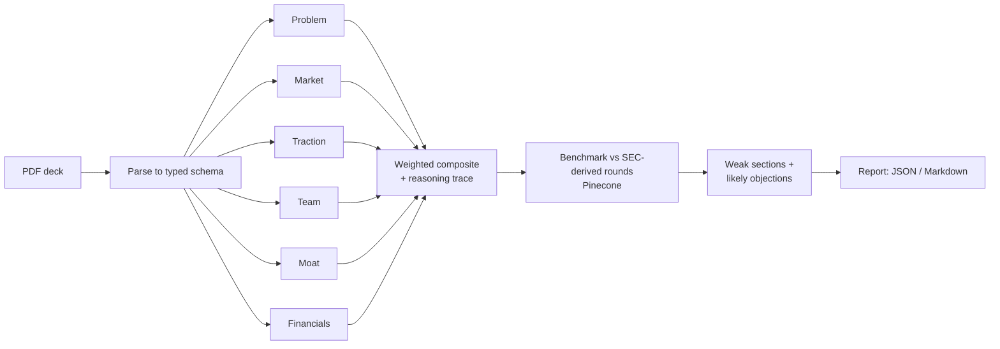

# AutoPitch

[](https://github.com/shamanth811/autopitch/actions/workflows/ci.yml)


An AI analyzer for VC pitch decks. Upload a PDF and get section-by-section scores with
reasoning, a weighted composite, a benchmark of the raise against comparable rounds from SEC
filings, and the objections a sector investor is most likely to raise.

**Stack:** Gemini 2.5 Pro · Llama 3.1 · LangGraph · Pinecone · FastAPI · LangSmith

## How it works



1. **Parse.** Slide text is extracted from the PDF and converted by Gemini into a typed
   pydantic `Deck` (problem, market, traction, team, moat, financials). Fields the deck does
   not state stay empty instead of being guessed.
2. **Score.** Six independent LangGraph nodes, one per section, run in parallel. Each scores
   its own section against a rubric, criterion by criterion, with a short reasoning trace.
3. **Combine.** Section scores are averaged in code and combined with stage-dependent weights
   (pre-seed favours team, Series A favours traction). Weights live in
   [`rubric.py`](src/autopitch/scoring/rubric.py) and can be tuned without touching graph code.
4. **Benchmark.** The deck is embedded and matched against private financing rounds extracted
   from SEC S-1 filings and stored in Pinecone. The ask is compared with the median same-stage
   round and unusual asks are flagged.
5. **Objections.** Weak sections and benchmark findings drive a list of the objections an
   investor in that sector would likely raise, with the evidence a founder should bring.

More detail and design rationale: [docs/ARCHITECTURE.md](docs/ARCHITECTURE.md).

## Quickstart

```bash
git clone https://github.com/shamanth811/autopitch.git
cd autopitch
python -m venv .venv && source .venv/bin/activate   # Windows: .venv\Scripts\activate
pip install -e ".[dev]"
cp .env.example .env                                # then add your keys
```

Run the test suite (offline, no keys needed):

```bash
python scripts/verify.py
```

Analyze a deck from the command line (needs Gemini and Llama keys):

```bash
python examples/make_sample_deck.py                 # writes a fictional sample deck
python scripts/analyze.py examples/acme_grid_deck.pdf --out reports/acme
```

Run the API:

```bash
uvicorn autopitch.api:app --port 8000
curl -F "file=@examples/acme_grid_deck.pdf" "http://localhost:8000/v1/analyze?format=markdown"
```

Build the SEC filing index (needs Gemini, Pinecone and a SEC-compliant user agent):

```bash
python scripts/ingest_filings.py --limit 25
```

## Configuration

All settings are environment variables prefixed `AUTOPITCH_`; see
[`.env.example`](.env.example). Without a Pinecone key the benchmark step is skipped and the rest
of the report is still produced. LangSmith tracing turns on when a LangSmith key is set.

## API

| Endpoint | Description |
|---|---|
| `POST /v1/analyze` | Multipart PDF upload. Returns the report as JSON, or Markdown with `?format=markdown`. |
| `GET /healthz` | Liveness check. |

Uploads are capped by size and page count, validated by content rather than the declared type,
processed in memory, and rate limited per client. Set `AUTOPITCH_API_KEY` to require an
`X-API-Key` header. See [SECURITY.md](SECURITY.md) for the threat model.

## Project layout

```
src/autopitch/
  parsing/     PDF -> slides -> typed Deck
  scoring/     rubric, per-section scorers, weighted composite
  retrieval/   EDGAR client, S-1 extraction, embeddings, Pinecone store, benchmark
  llm/         client protocol; Gemini, Llama (OpenAI-compatible), retry, fake
  graph.py     LangGraph pipeline
  objections.py, report.py, api.py, safety.py, tracing.py
scripts/       analyze, ingest_filings, verify
tests/         offline suite
```

## Testing

The suite runs offline: model, embedding and vector-store dependencies are behind interfaces
with deterministic in-memory implementations. `scripts/verify.py` runs lint, a format check and
the tests, and saves the raw logs and a JUnit XML file under `reports/`.

Automated tests verify wiring, schema validation, aggregation math, retrieval logic and the API's
security behaviour. They do **not** measure how good the model scores are; that needs labelled
decks and live models.

## Limitations

- The benchmark reflects companies that filed an S-1, so it is biased towards those that
  reached an IPO filing, and amounts come from LLM extraction of filing text.
- Scores are model judgements against a fixed rubric and are a screening aid, not investment
  advice.
- Image-only decks are rejected; there is no OCR step yet.
- The rate limiter is per process.

## License

MIT
