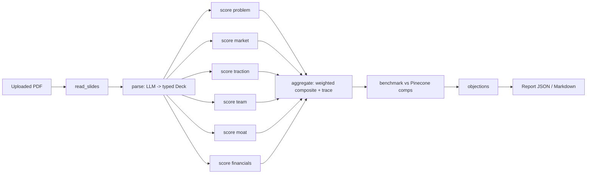

# Architecture

## Pipeline

The graph is defined in `src/autopitch/graph.py`. The six scorers run in parallel and share
no state; a list-append reducer merges their outputs at the join.

## Design decisions

**Independent section scorers.** Each scorer sees only its own section of the extracted deck.
A persuasive team slide cannot raise the market score, and each score has a clear provenance.

**Scores are computed in code.** The model returns per-criterion scores with reasoning. The
section score is their mean, and the composite applies stage-dependent weights
(`scoring/rubric.py`). The model never chooses weights or aggregates, which keeps results
auditable and limits what a prompt-injected model can influence.

**Stage-aware weights.** Pre-seed decks weight team and problem heavily because there is little
revenue to judge; Series A weights traction and financials.

**Unscorable sections are excluded, not zeroed.** If a scorer returns nothing valid, that section
is dropped and the remaining weights renormalised, and the exclusion is reported. A model
failure should not silently look like a bad startup.

**Two model roles.** Extraction and objections need long-context reading and synthesis; the
six scoring calls are narrow and parallel. Gemini 2.5 Pro can take the first role, and any
OpenAI-compatible host (Groq by default) takes the second. Gemini is optional: without it the
scoring model does both jobs. Both sit behind the `LLMClient` protocol, so either can be
swapped, and tests use a deterministic fake.

**OCR fallback.** `read_slides` extracts text with pypdf. Pages that yield none are extracted
into a small PDF and sent to Mistral OCR (`parsing/ocr.py`), which rotates across several API
keys: a 429 or quota error cools a key down for 5 minutes, a rejected key for an hour, and only
a malformed document fails immediately. If OCR fails but some pages had text, the deck is
analysed from those; if nothing was readable, the API returns a generic 502.

**Free-tier limits are a design input.** Scorer concurrency is capped (`SCORING_CONCURRENCY`),
the Groq client retries 429s with backoff, the Voyage client paces its calls, and the ingest
script sends a smaller filing excerpt when Gemini is not in use, so one request fits a
tokens-per-minute cap.

**Jobs, not long requests.** A full analysis takes about a minute, longer than many proxies
allow. The web app posts to `/v1/jobs`, which returns at once; `JobRunner` runs the graph in a
thread pool and streams it, writing the current stage to SQLite after each step. The UI polls
that stage for real progress. Only the finished report is stored, never the PDF; rows are keyed
by an anonymous per-browser owner id, expire after `RETENTION_DAYS`, and any job left running
by a dead process is marked failed at startup. The synchronous `/v1/analyze` remains for scripts.

**Swapping the database.** All persistence is in `storage.JobStore`. Moving to Postgres (for
example Supabase) means reimplementing that one class. It would also be the point to add real
authentication, replacing the owner id with a user id.

**Two benchmark layers, because the two SEC sources answer different questions.**

*Raise size: SEC Form D* (`retrieval/formd.py`, `scripts/ingest_formd.py`). Every US company
that raises through a private placement files a Form D, and the SEC publishes quarterly bulk
data sets. The ingest keeps equity raises by corporations and LLCs incorporated within five
years, in industry groups that can be startups (real estate, pooled funds and the like are
excluded), amounts between $25K and $5B, and only the latest of an amendment chain. Eight
quarters give about 5,600 raises in a local SQLite file. At analysis time the deck's sector is
mapped to Form D industry groups, and the report shows the quartiles of raise sizes and the
percentile of the ask. There is no model, no embedding and no API key in this path, so it is
fast, free and reproducible.

*Similar companies: SEC S-1* (`scripts/ingest_filings.py`). It searches EDGAR full-text for S-1
registration statements, locates the "Recent Sales of Unregistered Securities" section (and a
few alternative headings), extracts private financing rounds into typed `FundingPattern`
records with an LLM, embeds them (Voyage or Gemini) and upserts to Pinecone. Pattern ids are
derived from the round (company, stage, amount, year) so amended filings overwrite instead of
duplicating, and only one filing per company is ingested per run. At analysis time the deck is
embedded and the nearest rounds are retrieved (filtered by sector, widening if there are too
few). Matches below a similarity cutoff are dropped, one company can fill at most two slots, and
a same-stage median is only quoted from three or more comparables.

Both layers depend on the deck's sector, and sector is a judgement rather than a copied field.
Left as free text it was unstable (the same deck came back as "climate", "energy" and
"unknown"), so the extraction prompt now lists a fixed 14-label vocabulary
(`parsing/sector.py`), and `resolve_sector` validates whatever comes back: a label outside the
list is never passed through, and a deterministic keyword scorer (which declines to answer on
weak or tied evidence) fills in. Tests keep the vocabulary, definitions, keyword table and Form D
mapping in step.

There is also an optional dedicated classification call (`SECTOR_CLASSIFIER=true`): a small
prompt with a definition and tie-break rule per label, a reasoning field before the answer, and
an output type that cannot hold a label outside the list. It is off by default because it was
not measurably better. `scripts/eval_sector.py` compares the two on 20 hand-labelled decks; on
`gpt-oss-20b` the extraction call's own guess scored 90% strict, 100% benchmark-equivalent and
was identical across repeated runs, while the dedicated call scored 92%, 100% and 95%
(one deck flipped between `ai` and `saas`). The set is small, written by the classifier's
author and easy, so it is a regression check rather than an accuracy claim, and it may look
different on murkier real decks or a different model.

Limits. Form D has no stage and no description, so it says whether an ask is unusual in size,
not whether the company resembles anyone; its industry groups are coarse, and the amount is
"sold so far". The S-1 index covers only companies that filed for an IPO, so it has survivorship
bias, amounts come from LLM extraction, and it is small. Neither is a valuation.

**Graceful degradation.** Each benchmark layer is optional. Without Pinecone and an embedding
key the similar-companies layer is skipped, without the Form D database the raise-size layer
is skipped, and with neither the rest of the report is still produced. The Pinecone store also refuses to open an index
whose dimension differs from the embedder's.

## Testing approach

All model, embedding and vector-store dependencies are behind interfaces with in-memory
implementations, so the suite runs offline and deterministically. `tests/test_e2e_offline.py`
pushes a real PDF from `examples/` through the whole graph with stubbed models. That verifies
wiring and data flow, not model quality. Evaluating scoring quality needs labelled decks and
live models and is not covered by the automated suite.
