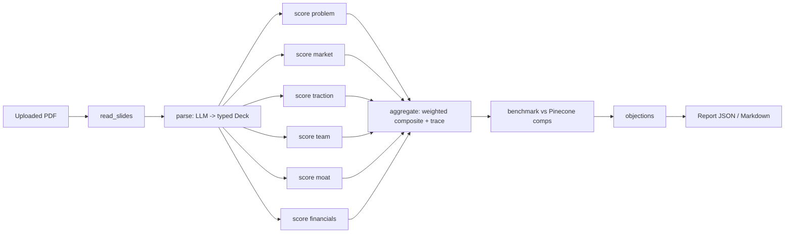

# Architecture

## Pipeline

The graph is defined in `src/autopitch/graph.py`. The six scorers run in parallel and share
no state; a list-append reducer merges their outputs at the join.

## Design decisions

**Independent section scorers.** Each scorer sees only its own section of the extracted deck.
A persuasive team slide cannot raise the market score, and each score has a clear provenance.

**Scores are computed in code.** The model returns per-criterion scores with reasoning. The
section score is their mean, and the composite applies stage-dependent weights
(`scoring/rubric.py`). The model never chooses weights or aggregates, which keeps results
auditable and limits what a prompt-injected model can influence.

**Stage-aware weights.** Pre-seed decks weight team and problem heavily because there is little
revenue to judge; Series A weights traction and financials.

**Unscorable sections are excluded, not zeroed.** If a scorer returns nothing valid, that section
is dropped and the remaining weights renormalised, and the exclusion is reported. A model
failure should not silently look like a bad startup.

**Two models, chosen by role.** Gemini 2.5 Pro handles extraction and objections, which need
long-context reading and synthesis. Llama 3.1 (any OpenAI-compatible host) handles the six
narrow, parallel scoring calls. Both sit behind the `LLMClient` protocol, so either can be
swapped, and tests use a deterministic fake.

**Retrieval over SEC filings.** `scripts/ingest_filings.py` searches EDGAR full-text for S-1
registration statements, locates the "Recent Sales of Unregistered Securities" section,
extracts private financing rounds into typed `FundingPattern` records with an LLM, embeds
them, and upserts to Pinecone. At analysis time the deck is embedded, comparable rounds are
retrieved (filtered by sector, widening if there are too few), and the deck's raise is compared
to the median same-stage round.

Limits of this benchmark: S-1 filers are companies that went on to file for an IPO, so the
index has survivorship bias, and amounts come from LLM extraction of filing text. It indicates
whether an ask is unusual for its stage; it is not a valuation.

**Graceful degradation.** Without Pinecone credentials the benchmark node is skipped and the
rest of the report is still produced.

## Testing approach

All model, embedding and vector-store dependencies are behind interfaces with in-memory
implementations, so the suite runs offline and deterministically. `tests/test_e2e_offline.py`
pushes a real PDF from `examples/` through the whole graph with stubbed models. That verifies
wiring and data flow, not model quality. Evaluating scoring quality needs labelled decks and
live models and is not covered by the automated suite.
